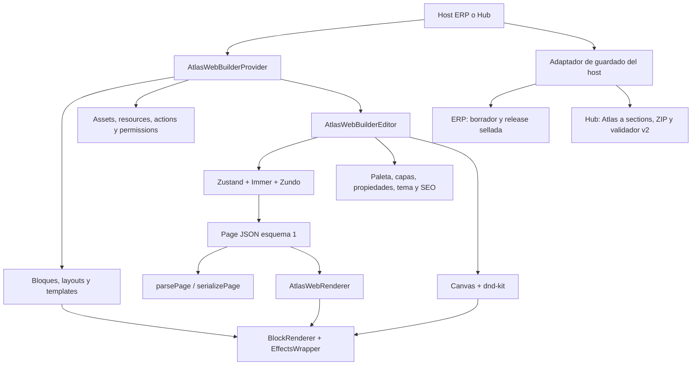

# Atlas Web Builder — Fase 0

Auditoría de arquitectura, versiones y compatibilidad. Corte: 13 de noviembre de 2026, America/Mexico_City. Revisión exclusivamente local y de lectura, con consultas públicas a npm y GitHub. No constituye certificación de producción.

## 1. Resumen ejecutivo

**Recomendación: no iniciar todavía la implementación de la Fase 1.** Primero debe reconciliarse la fuente remota de Atlas con la versión que ya consumen ERP y Developer Hub y acordarse un perfil de capacidades guardables. No hace falta reconstruir el motor desde el paquete: el checkout local conserva el código publicado.

La discrepancia inicial es real y tiene explicación verificable:

- GitHub `raulbellosom/Atlas-Web-Builder`, `main`: `0.2.3`, commit `b2210e7d594f730a5f8f7eec31b44238f867e6e4`.
- npm, etiqueta `latest`: `0.3.5`, `gitHead` declarado `dc30666923a6b4d19919a0e154bb4eb2cdd65e2f`.
- Atlas local, `main`: exactamente ese commit, versión `0.3.5`, árbol inicialmente limpio y 16 commits por delante del `main` remoto observado.
- Los tarballs de `0.2.3` y `0.3.5` superaron comprobaciones SHA-1 y SHA-512 contra sus metadatos del registro. Las 78 y 111 fuentes de sus sourcemaps, respectivamente, coinciden con los commits declarados, normalizando CRLF/LF. Los cinco archivos de `dist` locales coinciden byte a byte con npm `0.3.5`.

Esta evidencia permite atribuir las fuentes incluidas en el sourcemap de npm `0.3.5` al commit local indicado. **No se realizó una compilación reproducible ni una verificación criptográfica de attestations**; no se extiende esa conclusión a archivos que el paquete no contiene. El endpoint de commits de GitHub no encontró ese SHA (HTTP 422), y la única rama remota anunciada sigue en `0.2.3`.

**Destino del informe:** este repositorio es la fuente adecuada del motor: su nombre npm, origen Git, historial y artefactos locales coinciden con Atlas publicado. Por eso se guarda aquí el informe autorizado. Esto no implica que el `main` remoto esté listo como base de desarrollo: requiere sincronizar el historial local conservado en una tarea posterior.

Los catálogos ERP/Hub sí coinciden: **148 bloques**, digest canónico idéntico. También coinciden los nombres de sus campos con las definiciones cargadas del ERP y las instaladas en Hub. Sin embargo, un catálogo de bloques coincidente no cubre efectos, temas, SEO, assets, límites ni acciones dinámicas. Hay incompatibilidades reproducidas en esas fronteras.

## 2. Alcance, método y límites

Repositorios examinados: Atlas; `runly` como checkout de `Runly-MX/runly-erp`; `runly-developer-hub`. Se priorizó codebase-memory-mcp para arquitectura, símbolos y trazas. Se actualizó el índice de Atlas sin persistir artefactos en el repositorio: el índice anterior omitía subsistemas recientes. Para rutas Website ausentes o incompletas en los otros índices se usaron búsquedas y lecturas dirigidas de código.

Se revisaron el motor, las dos integraciones de editor, catálogos, serialización, conversores, lectores/escritores Website v2, MCP, guardado y preparación/importación/publicación. Se ejecutaron comprobaciones en memoria sobre módulos y paquetes existentes; no se instalaron dependencias ni se recompilaron archivos en disco.

Convenciones:

- **Comprobado:** observado en fuente actual, metadatos remotos o reproducción puntual; se indica cuál.
- **Riesgo:** consecuencia plausible cuyo flujo completo no se ejecutó.
- **Propuesta:** diseño futuro; no implica defecto existente.
- **No encontrado:** no existe en las superficies inspeccionadas; no es prueba de ausencia en todo el ecosistema.

La carga asumida es edición interactiva de páginas individuales y distribución de paquetes hostiles dentro de los límites del contrato. No se hizo benchmark ni auditoría integral de autenticación, pagos, infraestructura o base de datos.

**UI/UX:** revisión estática de JSX, CSS y contratos, sin capturas ni sesión visual. Se respetó la restricción de crear únicamente este informe. No se certifican contraste renderizado, navegación completa con lector de pantalla, gestos móviles, tamaños táctiles reales ni paridad visual entre navegadores. Las observaciones visuales no reproducidas se señalan como riesgos o propuestas.

## 3. Matriz de versiones y procedencia

### 3.1 Estado observado

| Componente | Fuente/versión | Evidencia y estado |
|---|---|---|
| Atlas remoto | `main`, `b2210e7d594f730a5f8f7eec31b44238f867e6e4`, `0.2.3` | `git ls-remote` y GitHub Contents API; lectura web de `package.json` confirma `0.2.3` |
| Atlas local | `main`, `dc30666923a6b4d19919a0e154bb4eb2cdd65e2f`, `0.3.5` | 16 commits descendientes del remoto, sin cambios locales iniciales |
| npm Atlas | `latest = 0.3.5` | Publicado `2026-11-05T02:17:49.233Z`; `gitHead` coincide con Atlas local |
| npm Atlas anterior | `0.2.3` | Publicado `2026-07-28T03:21:57.096Z`; `gitHead` coincide con remoto |
| ERP local | `main`, `d816415422232b5dd3223ac2934b11ff0a0cba3d` | Árbol inicialmente limpio; 1 commit por delante del remoto observado |
| ERP remoto | `main`, `605425975dd8c8ea6e5da663336b8a06f2d3a1b8` | Consulta remota en esta auditoría, sin fetch/pull |
| Hub local | `main`, `754c7d7e122e16386dfcf139def577ee2e48d2f0` | Árbol inicialmente limpio; 2 commits por delante del remoto observado |
| Hub remoto | `main`, `0729cf5df242474f29fff95603accb4fb5f56cd3` | Consulta remota en esta auditoría, sin fetch/pull |
| ERP `apps/desktop` | Atlas `0.3.5` exacto | Manifest y lock; React resuelto `19.3.1` en snapshot de Atlas |
| ERP `packages/website-blocks` | `@runly/website-blocks` `0.1.0`, privado; Atlas `0.3.5` exacto | Biblioteca de fuente dentro del workspace, peers React/ReactDOM `>=18` |
| Hub raíz | Atlas `0.3.5` exacto | Manifest y lock; React `19.3.0` |
| Hub website-blocks | Alias `@runly/website-blocks` → `@runly-mx/website-blocks@0.1.0-source.3a071090875b9f3803f895e00d78fc25a047e829` | GitHub Packages, alias exacto, integridad en lock y manifiesto adicional `shared-packages.lock.json` |
| Catálogo ERP/Hub | Esquema Atlas `1`, referencia de builder `0.3.5` | 148 bloques; SHA-256 `0e6f77787d7351448f05dc87af8b1f2bb701170a1077eacc76633d548216d248` |

Los SHAs de las ramas remotas representan la consulta puntual, no una garantía de que permanezcan iguales. El resto del informe describe los **checkouts locales indicados** y, cuando se especifica, los paquetes instalados del Hub; no presupone que estos estados estén desplegados.

### 3.2 Dependencias y artefactos

Los dos lockfiles consumidores fijan Atlas `0.3.5` con la misma integridad que npm:

```text
sha512-r/py2SOesIJLNzVCMoA/4Y4E4y6kFL9N2EUlF4SNFFPDCM5wrYGBbctPdRMuFbFH/XHh5lsvhSucXd3625wBJg==
```

El pinning directo es correcto. `workspace:*` de ERP para website-blocks es apropiado dentro del monorepo, pero no identifica una versión distribuible fuera de él. Hub sí distingue nombre lógico y paquete publicado con alias y revisión de fuente. No deben sustituirse esos aliases por copias locales sin pasar por sus verificadores de distribución.

Se compararon 87 archivos de fuente de website-blocks ERP frente al paquete instalado del Hub: sin diferencias tras normalizar finales de línea. La comparación binaria inicial señalaba diferencias por CRLF/LF, no divergencia funcional. En studio-interchange, 16 de 18 archivos de producción comparados fueron idénticos en bytes; difirieron `studio/fonts.js` y `studio/shape-properties.js`. No se presupone igualdad global de los dos paquetes ni igualdad de la lista de fuentes; debe verificarse antes de ampliar tipografía.

Atlas usa React/ReactDOM como peers `>=18`, dependencias runtime con rangos y Vite en modo biblioteca ESM/CJS. Las pruebas de Atlas están preparadas con React 18, mientras ambos consumidores resuelven React 19: el peer permite instalar, pero no sustituye la validación de ambos mayores. No se detectó por ello una regresión de React en esta auditoría.

### 3.3 Diferencias `0.2.3` → `0.3.5`

El historial local tiene 16 commits, 83 archivos cambiados, 5,120 inserciones y 177 eliminaciones desde `b2210e7`:

| Área | Diferencia verificable en Git |
|---|---|
| Media | `AtlasImage`, optimización cliente, variantes mediante AssetSource, lazy mount, metadatos de imagen |
| Temas | Generador de tema de marca y sección de marca en ThemeTab |
| Movimiento | Presets adicionales, cascada de hijos, parallax, CounterBlock y TypewriterBlock |
| Recursos | Contrato tipado de recursos, hooks, navegación y muestras |
| Formularios | FormBlock y DSL de campos/validación |
| Comercio | ProductGrid, ProductDetail, CategoryList, AddToCart, Cart, CheckoutSummary; store optimista |
| SEO | Construcción/análisis de meta, JSON-LD, render de head y panel con contexto del sitio/assets |
| Renderer | SSR seguro para hover; eliminación de placeholders de imágenes vacías en público |
| Responsive | Navbar con menú móvil; correcciones de overflow en hero/footer |
| Integración | `onLinkClick`, protección de navegación en canvas/preview, `ctx.parent` y `ctx.nested` |

La lista publicada incluye `0.2.4`, `0.3.0`, `0.3.2`, `0.3.3`, `0.3.4`, `0.3.5`; **no incluye `0.3.1`**, aunque existe un commit local que menciona esa versión. Un mensaje de commit no demuestra publicación.

### 3.4 Publicación y fuente canónica

No se encontraron tags locales/remotos ni GitHub Releases de Atlas en las consultas realizadas. Tampoco existe `.github` en este checkout. `package.json` no define scripts de release ni `prepublishOnly`. Hay instrucciones históricas de publicación manual, con build/pruebas y `npm publish`, en `docs/superpowers/plans/2026-07-27-ctx-resource-fix-plan.md`; no constituyen evidencia de qué pasos se ejecutaron para `0.3.5`. Algunas especificaciones conservan el texto «not published» pese a la publicación ya comprobada.

No hay cambios tracked/untracked iniciales en Atlas que se puedan calificar como «código local sin publicar». Sí hay **commits locales sin sincronizar a GitHub que ya están publicados en npm**. Son conceptos distintos. `dist` ignorado coincide con el paquete actual; no se auditó todo archivo ignorado como fuente potencial.

Decisión recomendada: Atlas Git debe ser la fuente canónica del motor, npm el artefacto distribuido y ERP la fuente de website-blocks/studio-interchange. Recuperar/sincronizar los 16 commits conservados, revisar el diff, documentar la cadena de release y crear referencias verificables corresponde a una tarea posterior. No evolucionar directamente el remoto `0.2.3`: eliminaría de la base funcional subsistemas que ya consumen los proyectos.

Fuentes remotas: [Atlas package.json en GitHub](https://github.com/raulbellosom/Atlas-Web-Builder/blob/main/package.json), [metadatos npm 0.3.5](https://registry.npmjs.org/@raulbellosom%2Fatlas-web-builder/0.3.5), [metadatos npm 0.2.3](https://registry.npmjs.org/@raulbellosom%2Fatlas-web-builder/0.2.3). npm se consultó directamente y sus tarballs se inspeccionaron en memoria; no se usó la página web como prueba de integridad.

## 4. Mapa de arquitectura



| Subsistema | Responsabilidad y frontera |
|---|---|
| `src/provider/` | Construye contexto y registros; el motor no incorpora auth, router ni base de datos |
| `src/registry/createBlockRegistry.js` | `defineBlock`, registro por `type`, rechazo de duplicados; definición React suministrada por aplicación confiable |
| `src/editor/AtlasWebBuilderEditor.jsx` | Shell, sensores Pointer/Keyboard, atajos, paneles móviles y preview |
| `src/editor/chrome/Canvas.jsx` | Regiones, selección y composición de wrappers editables; viewport simulado |
| `src/editor/store/` | Página y UI por instancia; historial temporal sólo de `page`, no de `theme` |
| `src/editor/fields/` | Controles de propiedades; `FieldRow` resuelve directamente en `defaultFields` |
| `src/theme/` | Tema del sitio y variables `--atlas-*`; colores del editor separados en CSS `--awb-*` |
| `src/renderer/` | Regiones/bloques recursivos, recursos, efectos, lazy mount y contexto de padre |
| `src/persistence/`, `src/schema/` | Validación estructural, migración, serialización y eliminación de huérfanos |
| `src/media/`, `src/assets/` | Imagen, optimización y contrato AssetSource opcional |
| `src/resources/`, `src/forms/`, `src/commerce/`, `src/seo/` | Capacidades adicionales de `0.3.x`; comercio/formularios requieren adopción explícita |
| ERP website-blocks | 128 bloques adicionales, estilos y clientes/acciones concretas Runly |
| ERP studio-interchange | Contrato declarativo y lector/escritor seguro del paquete Website |
| Hub Frame | Aísla Atlas en iframe, filtra bloques y convierte assets/tema; comunica snapshots por MessageChannel |
| Hub host/API | Revisiones, permisos, validación aislada y guardado del ZIP; Marketplace tiene su propio flujo de revisión/publicación |

Hay una frontera mejorable: `EffectsWrapper` importa `resolveFilter` desde un archivo de controles del editor. Es una dependencia comprobada del renderer hacia el editor, aunque el helper sea puro. Mover el helper compartido al runtime sería una propuesta de organización, no un fallo de ejecución demostrado.

## 5. Inventario de funcionalidades

| Capacidad | Estado | Alcance real / límite |
|---|---|---|
| Canvas visual | Implementada | DnD, slots, regiones, selección, inserción, movimiento y duplicación |
| Registro de bloques | Implementada | `defineBlock`, defaults, fields, groups, variants y render React; duplicados lanzan error |
| Propiedades | Implementada parcialmente | 15 tipos en defaultFields, grupos y efectos; sin política de capacidades del consumidor |
| Campos personalizados | Parcial / API incompleta | `defineField` existe, pero FieldRow usa sólo defaultFields y el editor no acepta `fieldTypes` |
| Temas de sitio | Implementada | Tokens editables, reset y generador de marca; bridge del host necesario para persistir tema |
| Tema de interfaz | Parcial | Namespace `--awb-*` separado; sin modo light/dark/system integrado ni selector público |
| Variables CSS | Implementada | Mapeo plano `--atlas-grupo-clave`; no es un schema completo ni validación de seguridad |
| Tipografía | Parcial | Familia/escala por tokens, pesos, interlineado, tracking y transformación en bloques; sin gestor general de carga de fuentes en Atlas |
| Fuentes Runly | Parcial/integrada | Lista cerrada Studio en v2; CSS de website-blocks aplica font.heading a encabezados; no equivale a cargar binarios de fuentes en cualquier host |
| Fondos | Implementada | Color/token, imagen/overlay y degradado lineal de dos extremos |
| Degradados avanzados | No encontrados | Sin modelo multiparada, radial, cónico ni editor de stops en las superficies inspeccionadas |
| Efectos | Implementada | Opacidad, entrada, scroll reveal, hover, filtros, transformación, cursor, sticky y z-index |
| Movimiento `0.3.x` | Implementada | 15 presets incluyendo none; stagger, parallax, counter/typewriter; reduced-motion en runtime |
| Assets | Implementada con adaptadores | List/upload/remove/getById/subscribe y uploadVariants opcionales; soporte concreto depende del host |
| Responsive | Parcial | Anchos desktop/tablet/mobile 1280/834/390; paneles overlay <=960; navbar con container queries; sin overrides generales por breakpoint |
| Columns stackOnMobile | Defecto comprobado | Campo expuesto y default true, pero su render no lo consume ni emite clase que lo active |
| Undo/redo | Parcial | Historial de página, máximo configurado en store; tema y estado de UI excluidos |
| Persistencia Atlas | Implementada parcialmente | Callbacks y JSON; no backend/autosave universal ni guardado automático de theme dentro de page |
| Renderer público | Implementada | Bloques registrados, regiones, SSR, recursos y efectos; depende de estilos/servicios que suministre el host |
| Migraciones JSON | Infraestructura implementada | CURRENT_SCHEMA_VERSION=1 y registro vacío; acepta versión futura con warning y serializador vuelve a 1 |
| SEO | Implementada en Atlas | Meta/análisis/head/JSON-LD/panel; Website v2 actual exige page.seo vacío |
| Formularios/comercio Atlas | Implementada, opt-in | No están todos en baseBlocks; las integraciones Runly usan sus propios bloques y bindings |
| Componentes React personalizados | Implementada en hosts confiables | Función render registrada en código; no admite cargar JS desde un documento/ZIP no confiable |
| Código/embed en plantilla Marketplace | Excluido por diseño | No HTML/CSS/JS/SVG/iframe arbitrario; VideoBlock también excluido del perfil portable |

## 6. UI/UX y hallazgos clasificados

Severidades: **alta** bloquea guardado, procedencia o compatibilidad material; **media** causa comportamiento incorrecto o extensibilidad/accesibilidad incompleta; **baja** afecta mantenimiento. No se declara vulnerabilidad explotable crítica sin reproducción.

### H01 — Alta: fuente remota de Atlas atrasada respecto al paquete consumido

**Comprobado remotamente y en Git local.** Empezar desde GitHub `0.2.3` excluye 16 commits ya publicados. La relación npm↔local tiene evidencia de gitHead, sourcemap e identidad de dist; el remoto no contiene el SHA publicado consultable. Corregir primero la sincronización/procedencia en una tarea autorizada. Si se omite, un release desde la rama remota puede reintroducir una base funcional antigua.

### H02 — Alta: efectos ofrecidos en Hub no se pueden guardar como Website v2

**Comprobado en código y en ejecución puntual.** `PropertiesPanel.jsx:165` añade controles universales sin consultar catálogo; ninguno de los 148 bloques del catálogo declara propiedades `_...`. El escritor v2 reproduce `prop_unknown` para HeadingBlock con `_opacity:0.5` o `_animation:{preset:'fade-in',duration:600}`. El mismo rechazo alcanza hover, filtros, transformaciones, sticky, cursor, z-index, stagger y parallax cuando se almacenan fuera del catálogo.

El ERP tiene una allowlist adicional en `website-block-effects.js`; el lector portable v2 no la utiliza. La solución propuesta es un perfil explícito que oculte/deshabilite controles no guardables y, en una revisión futura del contrato, efectos declarativos validados con los mismos límites. No admitir claves desconocidas de forma general.

### H03 — Alta: tema visible pero no representable; la indicación de deshacer no funciona para temas

**Comprobado en código y reproducción.** ThemeTab expone categorías planas como shadow, fontSize, radius y spacing. `portableTheme` sólo convierte colores, body/heading y determinadas escalas. Cambiar `shadow.md` produce el error «Este ajuste Atlas no se representa… Deshaz el cambio para guardar». Zundo sólo sigue `page`; cambiar un token de tema no añade una entrada al historial.

Un radio individual tampoco representa necesariamente el radio único de v2; spacing debe ser una escala coherente. Propuesta: filtrar controles según perfil, validar antes de aplicar, conservar un borrador reversible y definir si tema comparte historial con página. El reset disponible no sustituye deshacer individual y puede descartar otros cambios de tema válidos.

### H04 — Alta: panel Página/SEO ofrece estados que el formato no acepta

**Comprobado.** `RightPanel.jsx` permite editar SEO y visibilidad, incluyendo `draft`. `atlasPageToSections` rechaza SEO no vacío, regiones distintas de main, visibilidad distinta de public y claves adicionales con `PAGE_NOT_PORTABLE`. Se reprodujo el rechazo al añadir `seo.title`. El propio `validatePage` de Atlas admite sólo public/private: `draft` también rompe la exportación JSON normal.

Propuesta: restringir la UI al contrato actual y separar estado editorial de visibilidad. Una futura representación de SEO debe versionarse y probarse de extremo a extremo; no eliminar SEO silenciosamente.

### H05 — Media: stackOnMobile no cambia el render de ColumnsBlock

**Comprobado con render estático.** El campo existe, pero `render` no recibe `stackOnMobile`, y el div conserva gridTemplateColumns sin una clase responsive asociada. El HTML de render con true y false resultó idéntico. La simulación de viewport no resuelve esta ausencia. Implementación futura: comportamiento responsive explícito y prueba en el ancho real del contenedor.

### H06 — Media: versiones futuras se serializan como esquema 1

**Comprobado en memoria.** `parsePage` deja pasar schemaVersion=99 con warning; `serializePage` escribe CURRENT_SCHEMA_VERSION=1. Se reprodujo la secuencia 99→1 sin migración. No demuestra pérdida de una propiedad concreta, pero sí etiquetado incorrecto y riesgo al reabrir documentos de una versión futura. Propuesta: rechazar escritura de versiones futuras o abrir en modo lectura hasta disponer de migración compatible.

### H07 — Media: campos personalizados documentados sin ruta de inyección efectiva

**Comprobado estáticamente.** `defineField` valida/congela una definición, pero `FieldRow` sólo consulta defaultFields; AtlasWebBuilderEditor no recibe `fieldTypes`. La documentación que invita a suministrar campos propios excede esa API. Un bloque con tipo de campo nuevo muestra «Tipo desconocido». Propuesta: una ruta opcional de registro de controles por host, conservando defaultFields y sin importar @runly/ui obligatoriamente.

### H08 — Media: etiquetas accesibles y patrón de tabs incompletos

**Defectos estáticos concretos, sin certificación visual.** Los sliders de FilterField/TransformField usan un span como texto y no tienen label asociado ni aria-label/aria-labelledby. Cursor/z-index y campos de PageTab presentan el mismo patrón de etiqueta separada. Las tabs de RightPanel y BackgroundField tienen roles y aria-selected, pero carecen de la gestión completa de flechas/foco y asociación tabpanel en el código inspeccionado.

SelectField, TextField y NumberField sí envuelven sus controles en label; no se debe generalizar la carencia a toda la UI. Propuesta: FieldShell con ids, descripción/error y nombres accesibles; tabs accesibles y pruebas con teclado/lector de pantalla.

### H09 — Media: Ctrl/Cmd+Z intercepta la edición de texto

**Comprobado por orden del handler.** `AtlasWebBuilderEditor.jsx:94–107` llama preventDefault/undo antes de retornar por isFormField. Un usuario escribiendo en input/textarea/contenteditable activa historial de página en lugar de permitir el undo nativo del campo. El efecto exacto sobre selección/caret necesita prueba interactiva. Propuesta: política explícita para atajos dentro de campos y rich text.

### H10 — Media: combinar commerceBlocks de Atlas y Runly rompe el registro

**Comprobado en inventario runtime.** El conjunto actual baseBlocks + grupos Runly tiene 148 tipos únicos. Al añadir opt-ins de Atlas aparecen colisiones `ProductDetailBlock` y `CartBlock`; createBlockRegistry rechaza duplicados. No es un bug activo del conjunto actual. Es una incompatibilidad de extensión que bloquea la adopción ingenua de todos los bloques de Atlas.

Propuesta: decidir implementación por perfil y conservar identificadores existentes; si se necesitan nuevos tipos, introducirlos mediante un contrato nuevo con migración explícita. No renombrar ni eliminar tipos actuales como parte de esta auditoría.

### H11 — Media: renderer y backend ERP tienen límites distintos para efectos

**Comprobado en fuente.** Atlas limita skewX/Y a ±89 y filtro blur a 50, brillo/contraste a 300; el backend permite skew ±45, blur 40, brillo/contraste 200. Los controles actuales de filtro/transform no alcanzan todos los máximos del runtime, por lo que no se presenta como fallo de slider reproducido. Un JSON externo aceptable para el renderer puede guardarse como borrador estructural y fallar al publicar. Propuesta: contrato de efectos compartido y límites derivados de él, con pruebas de frontera; conservar el límite seguro más restrictivo hasta decidir.

### H12 — Baja: documentación de API/release desfasada

**Comprobado.** CLAUDE.md/documentación histórica aún menciona @racoondevs y describe dependencias externas como peers aunque varias son dependencies. Hay especificaciones «not published», ausencia de tags/releases consultados y documentación de custom fields que no coincide con el editor. Propuesta: corregir la documentación y registrar un procedimiento reproducible de publicación tras sincronizar la base.

### Observaciones y propuestas de UI que no se elevan a defectos visuales comprobados

- Los selects son elementos nativos, incluso donde CSS aplica appearance:none. Su popup sigue sujeto al navegador/OS. Native select no es por sí mismo un problema de accesibilidad.
- Inputs, selects y textarea ya comparten borde, padding y foco en editor.css:663. No hay evidencia para afirmar que todos tienen estilos incongruentes. Botones, swatches y filas compactas tienen dimensiones distintas por CSS; deben verificarse visualmente antes de unificar densidad.
- No hay dark mode integrado del chrome. Los namespaces de editor/sitio ya están separados: falta una API y reglas explícitas de alcance, no separar todo desde cero.
- Los paneles tienen anchos de tokens (272/312) y overlays móviles; no se encontró redimensionamiento de panel por usuario. Riesgos de foco, cierre con Escape y solapamiento requieren sesión real, no se declaran reproducidos.
- Ya existen sliders para efectos y controles de color/degradado. La mejora útil es un editor de colecciones para datos separados por líneas/`|`, selectores visuales de layout y tipografía, no reemplazar todos los controles indiscriminadamente.

## 7. Bloques, exposición y duplicación

### 7.1 Inventario y superficies

| Conjunto | Tipos cargados | Fuente |
|---|---:|---|
| Atlas baseBlocks | 20 | src/blocks/index.js |
| Runly universal | 108 | packages/website-blocks/src/index.js y registros asociados |
| Runly ecommerce | 18 | Incluye componentes propios de catálogo/carrito y familia Mercado |
| Runly bookings | 1 | BookingFormBlock |
| Runly restaurant | 1 | MenuGridBlock |
| Combinación actual | 148 únicos | Igual conjunto de tipos que catálogos ERP y Hub |
| Atlas opt-in no añadido por estas integraciones | 7 definiciones | FormBlock + 6 commerceBlocks; dos colisionan con tipos Runly |

| Editor/superficie | Exposición efectiva por código |
|---|---|
| Atlas genérico | Los bloques que entregue el host; baseBlocks no se registra de forma universal implícita |
| ERP WebsitePageEditorScreen | 20 base + 108 universal; añade ecommerce/bookings/restaurant según siteType: 128/146/129/129 respectivamente |
| ERP renderer clásico | Todos los 148; admitir el tipo al render no certifica binding dinámico ni publicación |
| Hub Website Frame | Filtra por catálogo y siteKind; excluye VideoBlock, CartBlock, CartPageBlock y AccountPortalBlock: website/landing/blog 126, ecommerce 142, bookings 127, restaurant 127 |
| Hub preview | El mismo conjunto filtrado; ContactForm/BookingForm/BlogIndex/ProductsGrid/ProductCard/MenuGrid se sustituyen por Marker de demostración |
| Marketplace v2 | Catálogo + grupos + exclusiones + validación de propiedades, imágenes, formas y límites; no todo lo visible en un renderer es portable |

Los conteos se verificaron cargando definiciones reales del ERP y del paquete instalado de Hub con transformación en memoria, sin generar bundle en disco. Se verificaron identidad de tipos y claves de fields, no equivalencia de cada render ni de cada etiqueta.

### 7.2 Bloques con edición limitada y especialización

- AccountPortalBlock no expone campos. ContactFormBlock ofrece formId/successMessage/buttonLabel; BookingFormBlock cuatro campos. ProductCardBlock sólo productId/showPrice/showDescription; CartBlock sólo siteId. La UI de datos/estilo está delegada a renderers y servicios, no a un inspector completo.
- BentoGridBlock ofrece items/background; MarqueeBlock items/speed/background/size; Gallery, Team, testimonios, portfolios y familias de plantillas usan colecciones serializadas como texto. Editables no equivale a contar con formularios por elemento, reordenación y validación contextual.
- Hay familias especializadas Maya, Agency, Biz, Habitia, Dev, Im, Cr y Mercado. La especialización es real, pero no se ha demostrado que sean código muerto o duplicados eliminables: sus IDs forman parte de documentos y plantillas.
- Existen solapamientos de responsabilidad: Navbar/StoreNavbar/DevNavbar/ImNavbar/CrNavbar, Footer/SiteFooter/CrFooter/MercadoFooter, diversos heroes y pricing. Propuesta: compartir primitivas internas y controles preservando los bloques públicos; no fusionar documentos ni cambiar identificadores automáticamente.
- `allRunlyTemplates` de website-blocks exporta seis plantillas. Hay más archivos de plantillas y registros propios del ERP; no debe inferirse exposición pública sólo por la existencia del archivo. Hub no pasa templates al editor en Frame.

El anexo A enumera todos los IDs del catálogo sin modificarlos.

## 8. Compatibilidad de Website Template v2

### 8.1 Contratos distintos que no deben confundirse

| Capa | Contrato y comportamiento |
|---|---|
| Atlas Page | Esquema JSON 1, diccionario de bloques, regiones, props abiertas y SEO; valida principalmente estructura |
| ERP borrador | normalizeWebsiteDocument estricto: esquema 1, hasta 2 MiB, 1,000 bloques y profundidad 50; conserva metadata/tipos desconocidos; rechaza ciclos, referencias repetidas y huérfanos |
| ERP MCP sections | page-document.js: catálogo, hasta 300 bloques, profundidad 6, claves/valores y URLs; no declara la allowlist de efectos de publicación |
| ERP release builder | Conforma copia del documento, catálogo + allowlist de efectos, contenido seguro, assets fijados y bindings dinámicos; una página guardada no es una página publicable |
| Website package | runly.website-template, formatVersion=2, minReaderVersion=2, builder mínimo `0.3.5` y catalogDigest exacto; ZIP declarativo sin código ejecutable |
| Conversor Atlas→sections | Sólo main, público, SEO vacío, claves permitidas, árbol sin repetición/huérfanos, profundidad 6 y 300 bloques |
| Tema v2 | colors hex de 6/8 dígitos, fonts body/heading de lista cerrada, radius/spacing numéricos 0..64; sin fontSize/shadow ni escalas arbitrarias |
| Assets v2 | PNG/JPEG/WebP empaquetados, identificados por SHA-256 y asset:hash; inventario, dimensiones y licencias; no URLs externas de imagen |
| Hub MCP | JSON de documento máximo 900 KiB y ZIP 640 KiB; portal admite ZIP de 25 MiB; límite de transporte independiente del formato |
| Creator | iframe sandbox allow-scripts, puerto con secuencias, host autorizado, revisiones y guardado validado; guardar no publica ni firma |
| Importación ERP | Revalida bytes, permisos y revisiones; assets privados ligados al sitio; crea borradores, sin publicar automáticamente |

El lector v2 limita además 24 páginas, 300 bloques por página, 1,500 totales, profundidad de bloque 6, 100 assets y 64 MiB de assets; los techos ZIP incluyen 25 MiB comprimidos, 128 MiB expandidos, 256 entradas y límite por entrada de 10 MiB. El importador ERP impone **8 MiB por imagen**, de modo que un asset de más de 8 MiB que cumpla el techo del paquete puede rechazarse al importar. Es una diferencia comprobada de política, no una prueba de importación ejecutada.

### 8.2 Matriz de propiedades y efectos

| Dato/capacidad | Atlas | ERP | Hub/Marketplace v2 |
|---|---|---|---|
| Campos declarados y válidos del catálogo | Render/edición | MCP valida; draft conserva; release vuelve a verificar/conformar | Aceptados si el bloque/grupo está permitido |
| `_opacity`, `_animation`, `_hover`, `_scrollReveal` | Soportados | Allowlist específica al publicar | Rechazados prop_unknown |
| `_filter`, `_transform`, `_stagger`, `_parallax` | Soportados con sanitizers | Admitidos con límites parcialmente distintos | Rechazados prop_unknown |
| `_sticky`, `_zIndex`, `_cursor`, `_lazy`, `_lazyMinHeight` | Soportados | Allowlist específica | Rechazados prop_unknown |
| naturalWidth/naturalHeight/dominantColor | Soporte de imagen/metadatos | Allowlist backend; variantes no equivalentes | No catalogados; UI image con withAssetMeta:false; naturalWidth se reprodujo rechazado |
| SEO de página | Soportado | Documento y servicios SEO propios | Conversor exige SEO vacío |
| Visibilidad draft | Ofrecida por PageTab | Estado de borrador se modela aparte | No portable; Atlas serialize también rechaza draft |
| Custom block registrado en React | Soportado | Necesita catálogo, runtime, validadores y servicios | No entra por ZIP; sin catálogo versionado se rechaza |
| Vídeo/embed | VideoBlock en base | Runtime y política de publicación propios | VideoBlock excluido; iframe/HTML/JS prohibidos |
| Formulario | FormBlock opt-in / bloques host | formId local y permisos; BookingForm bloqueado para publicación en ruta revisada | Sólo marcadores @contact/@newsletter; calendarId debe estar vacío |

Los presets de entrada Atlas son: none, fade-in, slide-up/down/left/right, zoom-in/out, blur-in, rotate-in, flip-up y slide-fade-up/down/left/right. El backend ERP deriva parte de sus opciones de EFFECT_PRESETS/EFFECT_SHAPES, pero no todos sus límites. **No hay soporte universal de esos efectos en Website v2 por el hecho de estar exportados por Atlas.**

### 8.3 Guardar y reabrir

1. **Atlas standalone:** page conserva props en JSON y elimina bloques huérfanos al parsear/serializar. Tema vive fuera de page y sólo persiste si lo recoge el host; undo/redo sólo restaura page.
2. **ERP:** WebsitePageEditorScreen envía document, expectedRevision, Idempotency-Key y, si cambia, themeTokens/expectedSiteRevision. El bridge de tema existe. saveDraft aplica transacción y control de revisión; no se observó eliminación deliberada de props en ese guardado estructural. No se ejecutó contra DB.
3. **Hub:** StoreBridge obtiene page/theme; mapWebsiteImages convierte imágenes a asset:hash; portableTheme rechaza cambios sin representación; website_write convierte a sections, genera ZIP y vuelve a validar. Se crea una revisión con expectedRevision; open vuelve a reconstruir Page y assets. Bloques adquieren IDs de reconstrucción, no deben tratarse como identidad persistente externa.
4. **Exportador v2:** omite selects opcionales `''` que coinciden con defaults cuando no son opción explícita. Se reprodujo exportación válida de HeadingBlock size:''; esto evita un falso hallazgo de incompatibilidad de defaults.
5. **Temas:** no se demostró pérdida silenciosa en las cuatro categorías representables sin editar. El bridge conserva original y reemplaza colors por tokens.color, por lo que puede añadir colores por defecto: el JSON no es idéntico aunque se conserven los valores originales. Fuera de esas categorías lanza error, no descarta cambios silenciosamente.
6. **ERP publicación/aplicación:** conformTemplateDocument elimina props desconocidas no reconocidas como efectos y ajusta selects; también expande el PricingBlock legacy con plans. En release opera sobre copia sellada, no reescribe el draft. Esto puede hacer que draft y público difieran. No debe usarse como sustituto de un contrato portable que rechace o explique cambios.
7. **Tema importado ERP:** mergeTemplateTokens sólo itera grupos existentes en el tema base; no crea grupos arbitrarios. font.heading se consume por CSS adicional de website-blocks; HeadingBlock Atlas aislado usa font.sans. La paridad exige conservar ese stylesheet/adaptador.

### 8.4 Seguridad e integración Marketplace

El ZIP sigue siendo datos: no se evalúan componentes, scripts o recursos remotos de plantilla. El lector valida inventario/digests, claves inseguras de JSON, textos/HTML permitido, enlaces, imágenes raster y derechos. El Hub ejecuta el validador en proceso aislado con restricciones, y verifica digests de entrada/salida. El iframe no recibe allow-same-origin; el handshake del Frame comprueba padre/origen y usa secuencias crecientes.

El importador ERP comprueba catálogo y bytes, permisos de páginas/tema/archivos/formularios, expectedRevision, idempotencia, bindings privados, checksums y cambios concurrentes. Hay staging/compensación y revalidación del origen antes de aplicar. Estos mecanismos se inspeccionaron en código; no se certificó su comportamiento con fallos reales o concurrencia contra producción.

Diferencias que requieren tratamiento explícito: límites MCP/portal/ERP; assets de 8 vs 10 MiB; fuentes permitidas instaladas frente a fuente ERP; formularios de demostración frente a bindings; cart/account excluidos; efectos/SEO/temas del inspector. Mantener validaciones de seguridad cerradas y comunicar la incompatibilidad antes de permitir la edición.

## 9. Decisiones arquitectónicas recomendadas

Son propuestas para fases posteriores, no cambios realizados:

1. **Canon por responsabilidad.** Atlas Git→npm para motor; ERP→paquetes compartidos para bloques/interchange; Hub mantiene catálogo de lector fijado por digest. Registrar qué fuente/commit/artefacto produce cada release.
2. **Perfil de capacidades del host.** Empezar con metadatos/adaptador opcional para campos, efectos, tema, SEO, assets y límites. El perfil del inspector debe derivarse del contrato activo, no de `builderVersion` a solas. Mantener uso standalone compatible.
3. **Primitivas UI internas pequeñas.** FieldShell, Text/NumberInput, Select/Combobox, Slider con entrada numérica, Toggle, Tabs, Popover/Dialog, ColorPicker, colección editable y grupos de propiedades. Reutilizar controles existentes y centralizar tamaño/foco/error. No imponer un framework nuevo para este trabajo.
4. **@runly/ui opcional.** Atlas conserva componentes/CSS propios y permite sustituir controles o slots en un adaptador del consumidor. Evitar imports de @runly/ui en el runtime base y compartir semántica de fields, no JSX del ERP en documentos.
5. **Dos temas explícitos.** EditorTheme light/dark/system usa --awb-* y no se exporta al website; WebsiteTheme usa --atlas-* y sí tiene contrato portable. Persistencia e historial definidos para cada uno. El canvas mantiene el aspecto del sitio al cambiar sólo el editor.
6. **Datos antes que CSS arbitrario.** Tipografía, backgrounds y efectos deben tener estructura declarativa, schema, rangos, defaults y degradación. Las migraciones se diseñan antes de añadir valores que el lector actual no sabe representar.
7. **Reutilizar sin romper IDs.** Extraer primitivas internas de familias especializadas cuando haya repetición demostrable. No eliminar bloques ni cambiar tipos de documentos existentes.
8. **Runtime confiable separado de plantilla.** Custom React render sólo desde código del host; una plantilla declara un tipo/capacidad registrada. Code/embed exige política/sandbox dedicado y versión nueva cuando afecte al paquete. No habilitar HTML/JS de ZIP a través de una propiedad genérica.
9. **Errores antes del guardado.** Rechazar edición incompatible o mostrar diagnóstico preciso antes de snapshot/export; no conformar silenciosamente contenido del Marketplace. Conservar documento y revisión anterior recuperables.
10. **Contrato de ida y vuelta.** Para cada propiedad soportada, fixture de documento→editor/snapshot→writer→validator→reader→ERP→renderer. Aceptar normalizaciones documentadas, como defaults omitidos e IDs regenerados; no pérdida silenciosa de valor.

## 10. Roadmap por fases

### Preparación obligatoria antes de Fase 1

Repositorios: los tres. Revisar/sincronizar historial de Atlas `dc30666` y commits locales de consumidores; conservar npm 0.3.5 y sus locks hasta decidir una release nueva. Documentar procedencia, comandos de build, verificación de paquete y catálogo, tags/releases y responsables. Acordar alcance del perfil Website v2 y registrar H01–H04 como trabajo previo/incluido en Fase 1.

Prueba requerida futura: checkout limpio de la fuente reconciliada produce el API/artefacto esperado, comparación con 0.3.5 y smoke de ambos consumidores. Aceptación: nadie necesita depender de commits que sólo existan en una máquina para reproducir el punto de partida. Esta auditoría no ejecuta esa sincronización.

### Fase 1 — UI/UX, dark mode y propiedades

| Aspecto | Propuesta |
|---|---|
| Repositorios/archivos | Atlas fields/, PropertiesPanel, RightPanel, ThemeTab, AtlasWebBuilderEditor, store, editor.css; Hub Frame/portable/WebsiteEditor; ERP WebsitePageEditorScreen |
| Dependencias | Base reconciliada; perfil actual v2; reutilizar dependencias existentes, @runly/ui sólo por adaptador |
| Contratos | Props opcionales de editor para perfil/controles/editorTheme; sin cambiar el JSON website por cambiar el chrome; política explícita de persistencia/historial de tema |
| Riesgos | Romper CSS del host, confundir temas, foco en overlays, controles que reaparezcan sin soporte de guardado, atajos de texto |
| Pruebas | Unitarios de resolución de fields/perfil/tema; teclado y nombres accesibles; guardado/reapertura de color y campos; errores de SEO/efectos evitados; smoke desktop y móvil de ambos hosts, light/dark/system |
| Aceptación | Ningún control disponible produce un cambio conocido imposible de guardar; tema del editor no modifica documento; tema website conserva valores; inputs/tab/dialog son utilizables con teclado; no cambian IDs ni documentos existentes |

### Fase 2 — Tipografía, degradados y estilos avanzados

| Aspecto | Propuesta |
|---|---|
| Repositorios/archivos | Atlas theme/, brand.js, BackgroundField, _background, Heading/Text/RichText; ERP website-blocks/typography.css y studio-interchange; Hub portable y catálogos |
| Dependencias | Primitivas/perfil de F1, inventario acordado de fuentes y mecanismo de carga confiable |
| Contratos | Versionar extensión de tokens/gradientes sólo si se necesitan stops u otras formas; mantener lector de color/string/gradiente de dos extremos; no introducir CSS libre |
| Riesgos | Font fallback diferente, licencia/carga de fuentes, pérdida de escalas o tokens durante conversión, cambio de métricas/text wrapping |
| Pruebas | Fixtures de familia/peso/tamaño, CSS de headings sin host especial, gradient roundtrip, validación de límites, compatibilidad de documentos 1 y paquetes v1/v2, fuentes permitidas ERP/Hub |
| Aceptación | Estilos compatibles sobreviven guardado y reapertura sin pérdida; valores nuevos se rechazan claramente en lectores antiguos; fuentes cargadas o fallback documentado; contrato/digest sólo cambia mediante revisión explícita |

### Fase 3 — Efectos, animaciones y responsive

| Aspecto | Propuesta |
|---|---|
| Repositorios/archivos | Atlas effects.js/EffectsWrapper, campos de efectos, Canvas y bloques layout/navbar; ERP website-block-effects/release; studio-interchange validator/writer; Hub Frame/catalogs |
| Dependencias | Perfil F1; resolver rango común de efectos y modelo de breakpoints |
| Contratos | Efectos tipados compartidos; esquema explícito de overrides por breakpoint si se introduce; nuevo lector/perfil para capacidades fuera de v2 actual |
| Riesgos | CSS no determinista, diferencias container/viewport, hydration, coste de observers, composición hover/transform/parallax, reduced-motion, lectores antiguos |
| Pruebas | Fronteras numéricas y enums, documento con cada efecto hasta render público, SSR/hidratación, reduced-motion, Columns stackOnMobile real, móvil/tablet/escritorio, navegadores en rutas CSS afectadas |
| Aceptación | Un mismo dato produce efecto y límites equivalentes entre editor/backend/renderer; ninguna animación oculta contenido sin JS; responsive se comprueba en contenedor; documentos antiguos siguen abriendo |

### Fase 4 — Código, embeds seguros y componentes personalizados

| Aspecto | Propuesta |
|---|---|
| Repositorios/archivos | Atlas registry/provider/renderer y fields; ERP catálogo/release/aislamiento; Hub contrato, iframe, validador y políticas Marketplace |
| Dependencias | Contrato versionado de capacidades y separación host confiable/plantilla; revisión de seguridad del tipo concreto |
| Contratos | Componentes compilados sólo en host; embeds como proveedores/orígenes/parámetros permitidos; bloque de código textual separado de ejecución; paquete ejecutable sería otro contrato explícito, no extensión implícita v2 |
| Riesgos | XSS, escape de iframe, URLs/orígenes inseguros, exfiltración y dependencias no presentes; choque de IDs existentes |
| Pruebas | Carga de custom block confiable, rechazo desconocidos, payloads hostiles HTML/URL/CSS, CSP/sandbox/orígenes, accesibilidad del embed y fallback, compatibilidad de lectores |
| Aceptación | Website v2 actual sigue rechazando ejecución arbitraria; cada capacidad nueva tiene política y fallback; no se relajan validaciones generales ni se renombra catálogo existente |

### Fase 5 — Compatibilidad completa con Runly Marketplace

| Aspecto | Propuesta |
|---|---|
| Repositorios/archivos | Los tres; ERP studio-interchange/website-blocks/import/preparation/release; Hub builder-catalogs, nativeWebsite, MCP website-tools, Creator, validación y distribución |
| Dependencias | Contratos estabilizados F1–F4, lectores versionados y artefactos reconciliados; conservar soporte de paquetes existentes |
| Contratos | Matriz builder/runtime/catalogDigest/format/reader/policy; capacidades y límites publicados por MCP; adapters de migración explícitos y política de degradación |
| Riesgos | Discrepancia de catálogos/paquetes, revocación entre inspección e importación, assets sin binding o con límites distintos, revisiones concurrentes y pérdida de propiedades |
| Pruebas | Corpus compartido de roundtrip y fixtures hostiles; MCP+portal; export/import ERP privado, binding de formularios/assets, conflictos/idempotencia, publicación/rollback en entorno de prueba; pruebas dirigidas de aislamiento; certificación de release al final |
| Aceptación | Cada propiedad declarada como soportada recorre todo el flujo; casos incompatibles fallan antes de editar/exportar o muestran migración explícita; imports crean borradores; publicación conserva permisos, revisión y trazabilidad; ningún lector ejecuta contenido de plantilla |

## 11. Criterios para autorizar Fase 1

- [ ] Fuente remota Atlas reconciliada con `0.3.5`, o base equivalente revisada y accesible; evidencia de paquete conservada.
- [ ] Estado local/remoto de ERP y Hub reconciliado o fijado expresamente como baseline del trabajo; no asumir despliegue de commits locales.
- [ ] Decisión aprobada sobre el perfil Website v2: efectos, SEO, tema y visibilidad que podrán editarse; mantener el validador cerrado.
- [ ] Casos H02–H04 reproducidos como fixtures del trabajo posterior y criterio de «no ofrecer cambios no guardables» incluido en F1.
- [ ] Política de editorTheme/websiteTheme, persistencia e historial acordada; solución a la indicación de deshacer temas.
- [ ] Alcance de F1 mantiene JSON/IDs existentes y no añade obligatoriamente @runly/ui.
- [ ] Flujo visual accesible disponible para verificar teclado, overlays móviles, light/dark y guardado/reapertura en ambos hosts.
- [ ] Matriz de validación proporcional y entorno de prueba definidos; sin publicación ni cambios de producción implícitos.

**Estado al cierre: no listos para implementar Fase 1.** Sí hay base local recuperada y evidencia suficiente para preparar la reconciliación y el diseño de F1. Los bloqueos reales son procedencia remota y contrato efectivo del inspector; no falta acceso al código publicado de Atlas.

## 12. Evidencia local y verificaciones

Rutas relativas a este informe; ERP y Hub son repositorios hermanos. Las referencias a commits locales no encontrados en GitHub se mantienen como evidencia local, no como enlaces remotos inexistentes.

| Evidencia | Archivos relevantes |
|---|---|
| Versiones/API/distribución Atlas | [package.json](../../package.json), [vite.config.js](../../vite.config.js), [src/index.js](../../src/index.js) |
| Editor y controles | [AtlasWebBuilderEditor](../../src/editor/AtlasWebBuilderEditor.jsx), [PropertiesPanel](../../src/editor/chrome/PropertiesPanel.jsx), [RightPanel](../../src/editor/chrome/RightPanel.jsx), [fields](../../src/editor/fields/index.js) |
| Tema e historial | [ThemeTab](../../src/editor/chrome/ThemeTab.jsx), [store](../../src/editor/store/createEditorStore.js), [defaultTheme](../../src/theme/defaultTheme.js), [editor.css](../../src/styles/editor.css) |
| Persistencia/esquema | [serializePage](../../src/persistence/serializePage.js), [migrate](../../src/schema/migrate.js) |
| Runtime y responsive | [BlockRenderer](../../src/renderer/BlockRenderer.jsx), [effects](../../src/renderer/effects.js), [ColumnsBlock](../../src/blocks/ColumnsBlock.jsx), [baseBlocks](../../src/blocks/index.js) |
| Bloques Runly | [index](../../../runly/packages/website-blocks/src/index.js), [package](../../../runly/packages/website-blocks/package.json), [typography](../../../runly/packages/website-blocks/src/typography.css) |
| Catálogo ERP | [block-catalog](../../../runly/apps/api/src/routes/website/block-catalog.json), [MCP sections](../../../runly/apps/api/src/routes/website/page-document.js) |
| Editor/renderer ERP | [WebsitePageEditorScreen](../../../runly/apps/desktop/src/modules/runly.website/screens/WebsitePageEditorScreen.jsx), [WebsitePageRenderer](../../../runly/apps/desktop/src/website/WebsitePageRenderer.jsx) |
| Guardado/publicación ERP | [draft-service](../../../runly/apps/api/src/services/website-draft-service.js), [effects validator](../../../runly/apps/api/src/services/website-block-effects.js), [release-service](../../../runly/apps/api/src/services/website-release-service.js), [conform](../../../runly/apps/api/src/services/website-template-conform.js) |
| Interchange | [website-template](../../../runly/packages/studio-interchange/src/website-template.js), [website-write](../../../runly/packages/studio-interchange/src/website-write.js), [website-document](../../../runly/packages/studio-interchange/src/website-document.js) |
| Importación ERP | [website-import-service](../../../runly/apps/api/src/services/marketplace/website-import-service.js), [preparation](../../../runly/apps/api/src/services/website-template-preparation-service.js), [template-service](../../../runly/apps/api/src/services/website-template-service.js) |
| Hub integración | [Frame](../../../runly-developer-hub/apps/web/src/website/Frame.jsx), [portable](../../../runly-developer-hub/apps/web/src/website/portable.js), [WebsiteEditor](../../../runly-developer-hub/apps/web/src/marketplace-console/WebsiteEditor.jsx) |
| Hub contratos/servicios | [catálogo](../../../runly-developer-hub/packages/contracts/website-builder-catalogs/0.3.5.json), [builder-catalogs](../../../runly-developer-hub/apps/api/src/services/marketplace-validation/builder-catalogs.js), [nativeWebsite](../../../runly-developer-hub/apps/api/src/services/marketplace-resources/website.js), [child](../../../runly-developer-hub/apps/api/src/services/marketplace-validation/child.mjs), [MCP](../../../runly-developer-hub/apps/api/src/mcp/website-tools.js) |
| Paquetes compartidos Hub | [shared-packages.lock](../../../runly-developer-hub/shared-packages.lock.json), [verify-website-source](../../../runly-developer-hub/scripts/verify-website-source.mjs), manifests/locks de ambos consumidores |

Verificaciones ejecutadas y resultados:

| Comprobación | Resultado |
|---|---|
| Estado/ramas/HEAD/remotos de los tres repos | Inicialmente limpios; divergencias cuantificadas, sin fetch/pull |
| npm metadata y tarballs 0.2.3/0.3.5 | Integridad SHA-1/SHA-512 correcta; 8 archivos por paquete |
| sourcemap↔commit declarado | 78/78 y 111/111 fuentes iguales tras normalizar EOL |
| dist local↔npm 0.3.5 | 5/5 archivos idénticos en bytes |
| Digest catálogos ERP/Hub | Idénticos y coincidentes con pin de builder-catalogs |
| Inventario de definiciones ERP/Hub instalado | 148 tipos únicos y ninguna diferencia de claves fields con catálogo |
| Bundle de inspección de website-blocks | En memoria con write:false; sin artefactos nuevos |
| Writer Website v2 baseline + select vacío | Paquete de 1,001 bytes válido; size:'' normalizado correctamente |
| Writer v2 con _opacity/_animation/naturalWidth | Rechazos esperados prop_unknown, reproducidos |
| Conversor con SEO no vacío | Rechazo esperado PAGE_NOT_PORTABLE |
| portableTheme con shadow editado / color admitido | Rechazo esperado de shadow; color conservado |
| Tema e historial | Cambiar un token no añade entrada undo |
| Esquema futuro | 99 parsea con warning y serializa a 1 |
| Columns stackOnMobile true/false | Render estático idéntico |

No se ejecutaron suites globales, E2E, build con salida a disco, pruebas con DB ni acciones de Marketplace remoto: no hay implementación que certificar y la solicitud restringe mutaciones. Las comprobaciones negativas fueron resultados esperados, no fallos de una suite. Tampoco se hicieron commits, push, publicaciones, migraciones ni cambios de versiones/locks/contratos.

El único archivo de repositorio creado por esta auditoría es este informe. La comprobación final de estado debe mostrar únicamente su nueva carpeta/archivo en Atlas y ningún cambio en ERP/Hub.

## Anexo A. IDs reales del catálogo

Inventario generado a partir del catálogo inspeccionado; no representa autorización automática para todas las superficies. Véanse las exclusiones y los conteos de la sección 7.

### base (20)

| ID | Propiedades declaradas |
|---|---|
| `NavbarBlock` | `variant`, `brand`, `logoSrc`, `logoHeight`, `showBrandName`, `links`, `ctaLabel`, `ctaHref`, `ctaVariant`, `height`, `maxWidth`, `paddingX`, `sticky`, `mobileBreakpoint` |
| `FooterBlock` | `variant`, `brand`, `tagline`, `columns`, `copyright`, `showBrand` |
| `HeroBlock` | `variant`, `eyebrow`, `title`, `titleSize`, `subtitle`, `ctaLabel`, `ctaHref`, `ctaVariant`, `ctaSecondLabel`, `ctaSecondHref`, `imageSrc`, `background`, `align`, `paddingY`, `minHeight`, `contentMaxWidth`, `shadow` |
| `SectionBlock` | `paddingY`, `paddingX`, `background`, `fullBleed`, `maxWidth`, `radius`, `shadow`, `border`, `borderColor` |
| `ContainerBlock` | `maxWidth`, `paddingX`, `background` |
| `ColumnsBlock` | `count`, `layout`, `gap`, `valign`, `paddingY`, `stackOnMobile` |
| `GridBlock` | `minItemWidth`, `gap` |
| `HeadingBlock` | `text`, `level`, `color`, `size`, `align`, `weight`, `lineHeight`, `letterSpacing`, `textTransform`, `maxWidth`, `paddingY` |
| `TextBlock` | `text`, `size`, `color`, `align`, `weight`, `lineHeight`, `letterSpacing`, `maxWidth`, `paddingY`, `paddingX`, `italic` |
| `RichTextBlock` | `html`, `size`, `color` |
| `CardBlock` | `variant`, `imageSrc`, `imageAlt`, `imageRatio`, `title`, `titleSize`, `titleWeight`, `description`, `descSize`, `ctaLabel`, `ctaHref`, `ctaStyle`, `align`, `padding`, `radius`, `shadow`, `background`, `borderColor` |
| `TestimonialBlock` | `variant`, `quote`, `author`, `role`, `avatarSrc`, `stars`, `accentColor`, `radius`, `shadow` |
| `PricingBlock` | `plan`, `price`, `currency`, `period`, `description`, `features`, `ctaLabel`, `ctaHref`, `highlighted`, `badge`, `radius`, `shadow` |
| `ImageBlock` | `src`, `alt`, `caption`, `link`, `aspectRatio`, `objectFit`, `width`, `align`, `radius`, `shadow`, `loading`, `draggable` |
| `VideoBlock` | `src`, `poster`, `caption`, `aspectRatio`, `width`, `align`, `radius`, `shadow`, `autoplay`, `controls`, `loop`, `muted` |
| `ButtonBlock` | `label`, `href`, `variant`, `size`, `color`, `radius`, `align`, `newTab` |
| `SpacerBlock` | `size` |
| `DividerBlock` | `color`, `thickness`, `marginY` |
| `CounterBlock` | `value`, `from`, `prefix`, `suffix`, `label`, `duration`, `decimals`, `locale`, `grouping`, `color`, `size`, `align` |
| `TypewriterBlock` | `prefix`, `phrases`, `suffix`, `typeSpeed`, `deleteSpeed`, `pause`, `loop`, `color`, `size`, `align` |

### universal (108)

| ID | Propiedades declaradas |
|---|---|
| `ContactFormBlock` | `formId`, `successMessage`, `buttonLabel` |
| `AccountPortalBlock` |  |
| `BlogIndexBlock` | `limit`, `columns`, `showExcerpt`, `siteId` |
| `ServicesGridBlock` | `eyebrow`, `title`, `subtitle`, `columns`, `services`, `cardStyle`, `align` |
| `TestimonialsBlock` | `eyebrow`, `title`, `columns`, `background`, `testimonials` |
| `StatsBlock` | `eyebrow`, `title`, `stats`, `background`, `align` |
| `GalleryBlock` | `eyebrow`, `title`, `subtitle`, `columns`, `gap`, `aspectRatio`, `zoom`, `image1`, `caption1`, `image2`, `caption2`, `image3`, `caption3`, `image4`, `caption4`, `image5`, `caption5`, `image6`, `caption6` |
| `CtaBannerBlock` | `eyebrow`, `title`, `subtitle`, `ctaLabel`, `ctaHref`, `ctaSecondLabel`, `ctaSecondHref`, `variant`, `size`, `align` |
| `FeaturesSectionBlock` | `eyebrow`, `title`, `subtitle`, `layout`, `iconStyle`, `background`, `features` |
| `TeamGridBlock` | `eyebrow`, `title`, `subtitle`, `columns`, `layout`, `team`, `photo1`, `photo2`, `photo3`, `photo4`, `photo5`, `photo6` |
| `SplitFeatureBlock` | `variant`, `eyebrow`, `title`, `body`, `ctaLabel`, `ctaHref`, `imageSrc`, `imageAlt`, `background`, `imageHeight` |
| `MarqueeBlock` | `items`, `speed`, `background`, `size` |
| `BentoGridBlock` | `items`, `background` |
| `QuoteBlock` | `quote`, `attribution`, `background`, `size`, `ornament` |
| `ShowcaseHeroBlock` | `eyebrow`, `title`, `highlight`, `subtitle`, `ctaLabel`, `ctaHref`, `ctaSecondLabel`, `ctaSecondHref`, `imageSrc`, `imageAlt`, `badgeValue`, `badgeLabel`, `shape`, `background` |
| `ProjectCardsBlock` | `eyebrow`, `title`, `subtitle`, `projects`, `image1`, `image2`, `image3`, `image4`, `image5`, `image6`, `columns`, `background` |
| `LogoCloudBlock` | `title`, `names`, `logo1`, `logo2`, `logo3`, `logo4`, `logo5`, `logo6`, `background` |
| `TopBarBlock` | `message`, `email`, `phone`, `hours`, `background` |
| `ParallaxSectionBlock` | `tone`, `shapes`, `speed`, `paddingY`, `minHeight`, `align` |
| `SiteFooterBlock` | `tone`, `brand`, `tagline`, `columns`, `copyright`, `showBrand`, `backToTop` |
| `FinHeroBlock` | `eyebrow`, `title`, `highlight`, `subtitle`, `ctaLabel`, `ctaHref`, `ctaSecondLabel`, `ctaSecondHref`, `trust`, `balanceLabel`, `balance`, `currency`, `transactions`, `loanTitle`, `loanAmount`, `loanNote` |
| `FinCalculatorBlock` | `eyebrow`, `title`, `subtitle`, `defaultAmount`, `defaultTerm`, `defaultRate`, `minAmount`, `maxAmount`, `currency`, `ctaLabel`, `ctaHref`, `disclaimer` |
| `FinLoanCardsBlock` | `eyebrow`, `title`, `subtitle`, `loans`, `rateLabel`, `columns`, `background` |
| `FinStepsBlock` | `eyebrow`, `title`, `subtitle`, `steps`, `background` |
| `FinClosingBlock` | `eyebrow`, `title`, `subtitle`, `ctaLabel`, `ctaHref`, `ctaSecondLabel`, `ctaSecondHref` |
| `LandscapeHeroBlock` | `scene`, `eyebrow`, `coordinates`, `title`, `highlight`, `subtitle`, `ctaLabel`, `ctaHref`, `ctaSecondLabel`, `ctaSecondHref`, `height`, `cue` |
| `ChapterBlock` | `scene`, `index`, `kicker`, `title`, `body`, `details`, `place`, `ctaLabel`, `ctaHref`, `flip`, `tone` |
| `MayaPortraitBlock` | `imageSrc`, `imageAlt`, `badgeValue`, `badgeLabel`, `note`, `chipOne`, `chipTwo` |
| `MayaTagBlock` | `text`, `tone`, `align` |
| `MayaTickerBlock` | `items`, `tone` |
| `MayaWorkBlock` | `eyebrow`, `title`, `highlight`, `subtitle`, `projects` |
| `MayaNotesBlock` | `eyebrow`, `title`, `highlight`, `testimonials` |
| `MayaPageHeroBlock` | `eyebrow`, `title`, `highlight`, `subtitle` |
| `MayaClosingBlock` | `eyebrow`, `title`, `highlight`, `subtitle`, `ctaLabel`, `ctaHref`, `email`, `phone`, `location` |
| `MayaPlansBlock` | `eyebrow`, `title`, `highlight`, `subtitle`, `currency`, `ctaLabel`, `ctaHref`, `plans` |
| `AgencyHeroBlock` | `eyebrow`, `tag`, `title`, `highlight`, `subtitle`, `ctaLabel`, `ctaHref`, `ctaSecondLabel`, `ctaSecondHref`, `size` |
| `AgencyMarqueeBlock` | `items`, `speed` |
| `AgencyWorkBlock` | `eyebrow`, `title`, `projects`, `ctaLabel`, `ctaHref` |
| `AgencyServicesBlock` | `eyebrow`, `title`, `services`, `showArrow` |
| `AgencyFactsBlock` | `stats` |
| `AgencyVoicesBlock` | `eyebrow`, `title`, `voices` |
| `AgencyTeamBlock` | `eyebrow`, `title`, `team` |
| `AgencyClosingBlock` | `eyebrow`, `title`, `highlight`, `email`, `ctaLabel`, `ctaHref`, `ctaSecondLabel`, `ctaSecondHref` |
| `BizHeroBlock` | `eyebrow`, `title`, `highlight`, `subtitle`, `ctaLabel`, `ctaHref`, `ctaSecondLabel`, `ctaSecondHref`, `proofs`, `panelLabel`, `panelValue`, `panelCaption`, `size` |
| `BizPillarsBlock` | `eyebrow`, `title`, `subtitle`, `items`, `background` |
| `BizKpiBandBlock` | `eyebrow`, `title`, `kpis` |
| `BizProcessBlock` | `eyebrow`, `title`, `subtitle`, `steps` |
| `BizCasesBlock` | `eyebrow`, `title`, `subtitle`, `cases` |
| `BizEngagementBlock` | `eyebrow`, `title`, `subtitle`, `models`, `prices`, `rows`, `highlight`, `ctaLabel`, `ctaHref` |
| `BizTrustBlock` | `title`, `clients`, `badges` |
| `BizClosingBlock` | `eyebrow`, `title`, `subtitle`, `points`, `ctaLabel`, `ctaHref`, `ctaSecondLabel`, `ctaSecondHref` |
| `RestoHeroBlock` | `size`, `eyebrow`, `title`, `accent`, `subtitle`, `ctaLabel`, `ctaHref`, `ctaSecondLabel`, `ctaSecondHref`, `boardTitle`, `dishes`, `stamp` |
| `RestoMenuBlock` | `eyebrow`, `title`, `subtitle`, `currency`, `tone`, `menu` |
| `RestoHoursBlock` | `eyebrow`, `title`, `hours`, `address`, `phone`, `note`, `ctaLabel`, `ctaHref`, `ctaSecondLabel`, `ctaSecondHref` |
| `SpaHeroBlock` | `size`, `eyebrow`, `title`, `accent`, `subtitle`, `ctaLabel`, `ctaHref`, `ctaSecondLabel`, `ctaSecondHref`, `inhale`, `exhale`, `facts` |
| `SpaRitualsBlock` | `eyebrow`, `title`, `subtitle`, `currency`, `rituals`, `ctaLabel`, `ctaHref` |
| `SpaClosingBlock` | `eyebrow`, `title`, `body`, `ctaLabel`, `ctaHref`, `ctaSecondLabel`, `ctaSecondHref`, `hours` |
| `HabitiaHeroBlock` | `issue`, `index`, `title`, `highlight`, `subtitle`, `ctaLabel`, `ctaHref`, `ctaSecondLabel`, `ctaSecondHref` |
| `HabitiaRoomsBlock` | `eyebrow`, `title`, `highlight`, `href`, `rooms` |
| `HabitiaPiecesBlock` | `eyebrow`, `title`, `highlight`, `pieces`, `ctaLabel`, `ctaHref` |
| `HabitiaMaterialsBlock` | `eyebrow`, `title`, `materials` |
| `HabitiaQuoteBlock` | `quote`, `attribution`, `folio`, `scene` |
| `HabitiaLeafletBlock` | `edition`, `title`, `highlight`, `subtitle`, `panels` |
| `HabitiaStoryBlock` | `eyebrow`, `year`, `title`, `highlight`, `body`, `signature`, `scene`, `flip` |
| `HabitiaFiguresBlock` | `eyebrow`, `title`, `figures` |
| `HabitiaPageHeroBlock` | `folio`, `title`, `highlight`, `subtitle`, `scene` |
| `HabitiaClosingBlock` | `eyebrow`, `title`, `highlight`, `subtitle`, `ctaLabel`, `ctaHref`, `note` |
| `DevNavbarBlock` | `brand`, `links`, `active`, `ctaLabel`, `ctaHref` |
| `DevHeroBlock` | `greeting`, `firstName`, `lastName`, `role`, `typedPrefix`, `phrases`, `description`, `ctaLabel`, `ctaHref`, `ctaSecondLabel`, `ctaSecondHref`, `status` |
| `DevAboutBlock` | `eyebrow`, `title`, `body`, `traits`, `linkLabel`, `linkHref`, `scene` |
| `DevSkillsBlock` | `eyebrow`, `title`, `skills` |
| `DevWorkBlock` | `eyebrow`, `title`, `linkLabel`, `linkHref`, `showFilters`, `allLabel`, `projects` |
| `DevPageHeroBlock` | `path`, `title`, `highlight`, `subtitle`, `scene` |
| `DevTimelineBlock` | `eyebrow`, `title`, `layout`, `items` |
| `DevProcessBlock` | `eyebrow`, `title`, `steps` |
| `DevSkillBarsBlock` | `eyebrow`, `title`, `subtitle`, `skills` |
| `DevStoryBlock` | `eyebrow`, `title`, `body`, `facts` |
| `DevValuesBlock` | `eyebrow`, `title`, `values` |
| `DevNowUsesBlock` | `nowTitle`, `nowItems`, `usesTitle`, `usesItems` |
| `DevCaseBlock` | `eyebrow`, `title`, `body`, `metrics`, `ctaLabel`, `ctaHref` |
| `DevContactBlock` | `title`, `highlight`, `subtitle`, `email`, `phone`, `location`, `connectTitle`, `socials` |
| `DevChannelsBlock` | `eyebrow`, `title`, `channels`, `availabilityTitle`, `availabilityStatus`, `availabilityItems` |
| `ImNavbarBlock` | `brand`, `links`, `active`, `ctaLabel`, `ctaHref` |
| `ImHeroBlock` | `eyebrow`, `title`, `highlight`, `text`, `ctaLabel`, `ctaHref`, `ctaSecondLabel`, `ctaSecondHref`, `stats` |
| `ImLogosBlock` | `label`, `brands` |
| `ImServicesBlock` | `eyebrow`, `title`, `highlight`, `lead`, `services` |
| `ImResultsBlock` | `title`, `highlight`, `text`, `ctaLabel`, `ctaHref`, `stats` |
| `ImProcessBlock` | `eyebrow`, `title`, `highlight`, `lead`, `steps` |
| `ImTestimonialCtaBlock` | `quote`, `name`, `role`, `ctaTitle`, `ctaText`, `ctaLabel`, `ctaHref` |
| `ImNewsletterBlock` | `title`, `text` |
| `ImPageHeroBlock` | `eyebrow`, `title`, `highlight`, `text`, `crumb` |
| `ImAboutBlock` | `eyebrow`, `title`, `highlight`, `body`, `checks`, `values`, `figures` |
| `ImServiceDetailBlock` | `items` |
| `ImPricingBlock` | `eyebrow`, `title`, `highlight`, `lead`, `currency`, `period`, `yearlyLabel`, `plans` |
| `ImFaqBlock` | `eyebrow`, `title`, `highlight`, `items` |
| `ImChannelsBlock` | `channels` |
| `CrNavbarBlock` | `brand`, `links`, `active`, `ctaLabel`, `ctaHref` |
| `CrHeroBlock` | `badge`, `badgeText`, `title`, `titleSoft`, `titleStrong`, `text`, `ctaLabel`, `ctaHref`, `ctaSecondLabel`, `ctaSecondHref`, `phoneTitle`, `topics`, `activeTopic`, `widgets` |
| `CrFeaturesBlock` | `eyebrow`, `title`, `highlight`, `lead`, `items` |
| `CrWindowBlock` | `badge`, `title`, `titleStrong`, `text`, `ctaLabel`, `ctaHref` |
| `CrStepsBlock` | `eyebrow`, `title`, `highlight`, `steps` |
| `CrVoicesBlock` | `eyebrow`, `title`, `highlight`, `stats`, `voices` |
| `CrPricingBlock` | `eyebrow`, `title`, `highlight`, `lead`, `currency`, `period`, `yearlyLabel`, `plans` |
| `CrFaqBlock` | `eyebrow`, `title`, `highlight`, `items` |
| `CrClosingBlock` | `title`, `highlight`, `text`, `ctaLabel`, `ctaHref`, `ctaSecondLabel`, `ctaSecondHref`, `formTitle` |
| `CrPageHeroBlock` | `eyebrow`, `title`, `highlight`, `text`, `crumb` |
| `CrContactBlock` | `title`, `text`, `channels` |
| `CrFooterBlock` | `brand`, `tagline`, `columns`, `copyright` |

### ecommerce (18)

| ID | Propiedades declaradas |
|---|---|
| `ProductsGridBlock` | `categorySlug`, `limit`, `columns`, `showPrice`, `showSearch`, `showCategories`, `showAddToCart`, `detailHref` |
| `ProductDetailBlock` | `addLabel`, `backHref`, `cartHref`, `zoomImage` |
| `CartPageBlock` | `mode`, `checkoutLabel`, `shopHref`, `promoNote` |
| `StoreNavbarBlock` | `variant`, `brand`, `links`, `cartLabel`, `cartHref`, `sticky` |
| `StoreHeroBlock` | `eyebrow`, `title`, `highlight`, `subtitle`, `ctaLabel`, `ctaHref`, `ctaSecondLabel`, `ctaSecondHref`, `badge`, `size` |
| `CollectionTilesBlock` | `eyebrow`, `title`, `tiles`, `linkLabel` |
| `TrustStripBlock` | `items`, `tone` |
| `ProductCardBlock` | `productId`, `showPrice`, `showDescription` |
| `CartBlock` | `siteId` |
| `MercadoHeaderBlock` | `announcements`, `brand`, `tagline`, `logoSrc`, `searchPlaceholder`, `searchHref`, `accountLabel`, `accountHref`, `wishlistLabel`, `wishlistHref`, `cartLabel`, `cartHref`, `allLabel`, `allHref`, `links`, `active`, `sticky` |
| `MercadoHeroBlock` | `slides`, `image1`, `image2`, `image3`, `sealTop`, `sealValue`, `sealBottom`, `trust`, `autoplay`, `interval` |
| `MercadoCategoriesBlock` | `title`, `items` |
| `MercadoPicksBlock` | `title`, `linkLabel`, `linkHref`, `categorySlug`, `limit`, `detailHref` |
| `MercadoPromoTilesBlock` | `tiles`, `image1`, `image2`, `image3` |
| `MercadoReviewsBlock` | `title`, `score`, `scoreLabel`, `reviews` |
| `MercadoNewsletterBlock` | `title`, `text`, `note` |
| `MercadoServicesBlock` | `items` |
| `MercadoFooterBlock` | `brand`, `tagline`, `social`, `columns`, `appTitle`, `appText`, `appStoreHref`, `playStoreHref`, `copyright`, `legal`, `region` |

### bookings (1)

| ID | Propiedades declaradas |
|---|---|
| `BookingFormBlock` | `calendarId`, `serviceDuration`, `successMessage`, `buttonLabel` |

### restaurant (1)

| ID | Propiedades declaradas |
|---|---|
| `MenuGridBlock` | `eyebrow`, `title`, `subtitle`, `currency`, `showPrices`, `columns`, `menu` |
