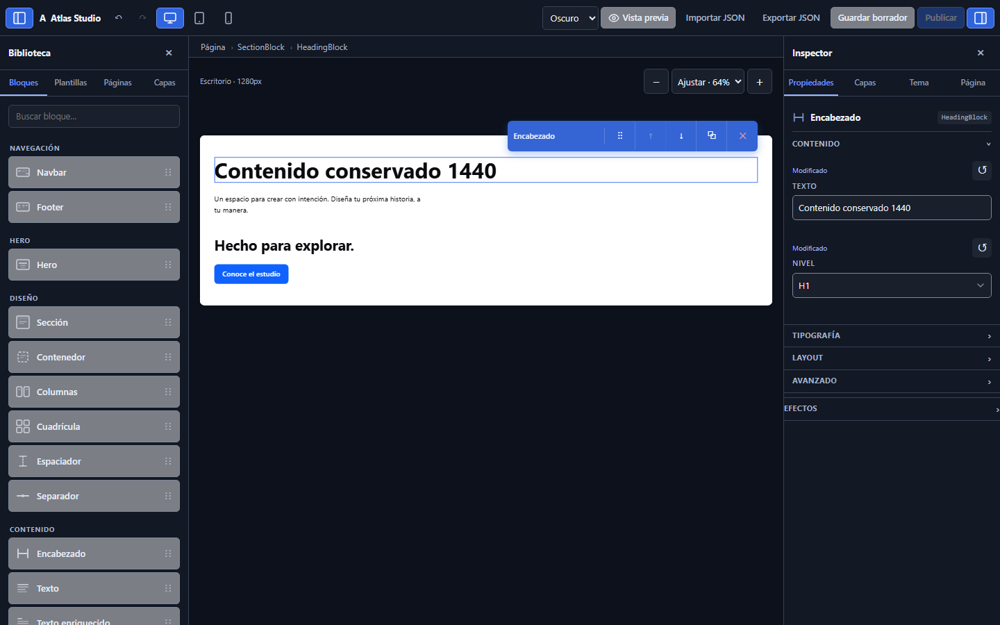
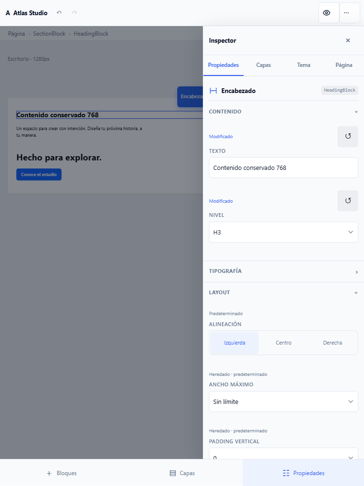
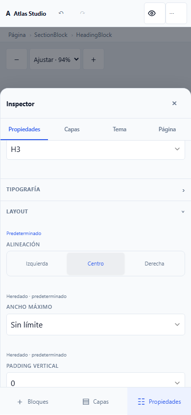

# Atlas — Fase 1: UI/UX del editor

Fecha: 2026-11-13. Estado: **APTO PARA REVISIÓN VISUAL DE FASE 1**.

Implementación local sobre `main`, partiendo de `e5a2939d9a28a7693f2339641f0e9a63b8c644ef`. No se crearon ramas ni worktrees. No se hicieron push, publicación npm ni despliegues. ERP y Developer Hub no se modificaron. La versión npm estable sigue siendo 0.4.0; esta UI todavía no forma parte de ella.

## Entrega funcional

### Corte A — Apariencias y overlays

- Light, dark y system mediante tokens semánticos de fondo, texto, foco, bordes, estados, sombras y superficies. El cambio del sistema se escucha en el documento propietario del editor.
- La apariencia no modifica Page, Theme, selección ni historial; tampoco remonta el editor. El website conserva su propia paleta y una página blanca permanece blanca en dark mode.
- Variables limitadas a `.atlas-wb-editor-scope` y `.atlas-wb-overlay-scope`, sin tokens en `:root`. Menús, comboboxes, tooltips y diálogos heredan la apariencia.
- Portales dentro del editor y su documento propietario, compatibles con iframe y fullscreen. Diálogos con foco inicial, Tab contenido, Escape y restauración al invocador. Las superficies anidadas cierran sólo la superior.
- Preferencia de movimiento reducido y estados de foco visibles. Se comprobaron contrastes AA de los pares de tokens principales; esto no equivale a una certificación completa de accesibilidad.

### Corte B — Controles e inspector

Se reutilizaron React, CSS y los sensores de @dnd-kit existentes. No se añadió una biblioteca UI ni se cambiaron dependencias o lockfiles.

| Componente | Comportamiento |
| --- | --- |
| `NumberInput`, `SliderInput` | Incrementos, límites, borrador inválido sin persistir y slider acompañado de número |
| `UnitInput` | px, %, rem, em, vh, vw y auto; expresiones desconocidas preservadas hasta reemplazo explícito |
| `SegmentedControl` | Alineación y opciones excluyentes; flechas, Home/End y foco itinerante |
| `Combobox` | Búsqueda, listbox, teclado y portal; sólo confirma opciones registradas |
| `SwitchControl`, `CheckboxControl` | Controles nativos etiquetados con presentación coherente |
| `ColorInput` | Selector nativo, borrador hexadecimal y swatches |
| `Popover`, `Tooltip` | Overlays aislados, acceso con teclado y foco |
| Campos existentes | Select nativo, texto multilínea, colores por token, espaciado, fondos y medios conservados |

Los metadatos de campo pueden optar por los tipos `slider`, `unit`, `segmented`, `combobox`, `switch`, `checkbox` y `color`. No se reescribieron los bloques para introducir formatos nuevos: los colores por token siguen guardando claves, y las unidades se usan donde el contrato ya admite una cadena CSS. Fondos y medios conservan sus estructuras compuestas y metadatos.

El inspector conserva las agrupaciones declaradas y organiza campos sin grupo en Contenido, Layout, Tipografía, Apariencia, Bordes y sombras y Avanzado. Efectos mantiene sus controles anteriores; opacidad incorpora slider y número. Las categorías se contraen y distinguen valores heredados, predeterminados, modificados y de sólo lectura.

Restablecer sólo aparece para campos editables con un valor predeterminado conocido; no se ofrece para medios con metadatos acoplados. Un tipo de control desconocido es de sólo lectura, sin restablecimiento. Las propiedades desconocidas se muestran como datos de sólo lectura y permanecen intactas. Se mantienen `CapabilityBoundary` y capacidades v1, incluidas las restricciones de efectos, SEO, temas y assets. No se tocaron validadores ni se incorporó ejecución de JavaScript.

### Corte C — Responsive, touch y teclado

- Escritorio: biblioteca/capas de 272 px, canvas central e inspector de 312 px; ambos paneles colapsables.
- Ancho del editor hasta 1100 px: drawers; hasta 600 px: inspector inferior y navegación Bloques/Capas/Propiedades. Se observa el ancho del contenedor, por lo que también funciona incrustado en un host estrecho.
- Paneles cerrados con `inert`, foco restaurado al invocador y un solo panel compacto abierto. Canvas visible tras el panel, sin bloquear el scroll global del host.
- Barra superior compacta con menú de acciones, sin perder guardar, publicar, importar/exportar, dispositivos o apariencia. Altura basada en visualViewport y áreas seguras CSS.
- Canvas con anchos lógicos 1280/834/390, ajustar, zoom 25–150% y desplazamiento. El zoom no se guarda en Page ni afecta al historial.
- Herramientas de bloque fuera del canvas escalado, con objetivos de 44 px. Selección sin navegar enlaces, incluidos los de nueva pestaña; vista previa conserva su comportamiento anterior.
- Ratón con distancia de activación 6 px; touch con pulsación de 220 ms y tolerancia 8 px. `touch-action: none` sólo en tiradores. El contenido y la biblioteca permiten scroll natural; tocar una tarjeta inserta un bloque.
- Corrección de colisión al reordenar bloques de alturas diferentes bajo zoom y del índice al mover hacia abajo. Se conserva la protección de ciclos del árbol.
- Alternativas: botones para mover bloques y teclado para arrastrar, seleccionar y recorrer capas. Instrucciones y anuncios de drag en español. Atajos limitados al editor y excluidos de diálogos.

## API pública nueva

Las nuevas props son opcionales:

```jsx
const [appearance, setAppearance] = React.useState('system')

<AtlasWebBuilderEditor
  blocks={baseBlocks}
  initialPage={page}
  theme={websiteTheme}
  capabilities={hostCapabilities}
  appearance={appearance}
  onAppearanceChange={setAppearance}
/>
```

`appearance` acepta `light | dark | system` en modo controlado. En modo no controlado, `defaultAppearance` establece el valor inicial y su valor por defecto es `system`. `onAppearanceChange(mode)` notifica la elección solicitada, no cada cambio de preferencia del sistema.

`useEditorAppearance()` devuelve `null` fuera del proveedor; dentro expone `appearance`, `resolvedAppearance` y `setAppearance`. Los componentes del editor pueden consumirlo. `editorControls` es un namespace público con los diez controles de la tabla anterior. Importación:

```js
import { useEditorAppearance, editorControls } from '@raulbellosom/atlas-web-builder'
const { NumberInput, Combobox, ColorInput } = editorControls
```

El CSS sigue entrando por `@raulbellosom/atlas-web-builder/styles`. `theme` continúa siendo el tema del website. Estas APIs requieren el futuro paquete con Fase 1, no el npm 0.4.0 actual.

## Compatibilidad con 0.4.0

`scripts/verify-phase1-compatibility.mjs` compara el build local con el tarball estable verificado. Resultado guardado en [compatibility.json](evidence/phase-1/compatibility.json):

- Se conservan los 140 exports anteriores; ahora hay 142, con igualdad de nombres ESM/CJS.
- `editorCapabilitiesVersion = 1`, sin cambio del contrato.
- Metadatos de bloques base idénticos: defaults, fields y slots.
- Serialización y reapertura exactas del documento de prueba con propiedades históricas desconocidas. El reloj se fija únicamente durante la comparación porque ambos serializadores actualizan `updatedAt`.
- HTML SSR público idéntico byte a byte para el fixture de compatibilidad, incluyendo efectos. Es evidencia dirigida, no una comparación exhaustiva de todos los sitios posibles.
- No hay cambios de Fase 1 en schema, migraciones, renderer, persistencia, bloques, registro, provider o tema del website. No se modificó el catálogo de Runly ni se repitió su auditoría de 148 bloques; tampoco se afirma haber certificado otra adopción de consumidores.

El tag `v0.4.0` permanece en `62e9688eba083cb8c4f82f00ee8075cca41681f1`. El tarball estable conserva SHA-256 `988739086c54ecb2e50843f5738a66008db38ec528f3d23df5eb20071c73c9c2`. `package.json` permanece en 0.4.0; no se reconstruyó ni sustituyó el artefacto estable, sólo se generó el build local de desarrollo.

## Validación y evidencia

### Pruebas dirigidas

82 pruebas distintas aprobadas en 16 archivos afectados: editor (1), apariencia (3), inspector/controles (5), colisiones (2), paneles responsive (1), edición inline (3), anidación/enlaces (2), capacidades (5), efectos (13), assets (11), tema (6), renderer (5), SSR (3), navbar móvil (5), store (7) y persistencia (10). Se corrigió el setup DOM para no afectar las pruebas SSR en entorno Node. No se ejecutó una suite global innecesaria.

`npm run lint`, `npm run build` y el verificador de compatibilidad: aprobados. El build genera ESM, CJS y CSS sin añadir dependencias. React Doctor: 75/100, cero errores y cinco advertencias: dos sobre complejidad de componentes y tres sobre sincronización de borradores numéricos/hex con cambios externos, reset y undo. No se deshabilitaron reglas para ocultarlas.

### Navegadores

| React | Chromium | WebKit |
| --- | --- | --- |
| 18.3.1 | 320×700, 390×844, 768×1024, 1024×768, 1440×900 aprobados | Los mismos cinco tamaños aprobados |
| 19.3.0 | Flujo completo 390×844, controles y casos de integración aprobados | Flujo completo 390×844, controles y casos de integración aprobados |

En cada tamaño de React 18 se probaron tres apariencias y cambios del sistema, selección, modificación, guardado/reapertura con remount del host, undo/redo, campos y reset, overlays/foco, navegación por teclado y ausencia de overflow horizontal del host. También se comprobaron controles nuevos, capacidades restringidas, preview, ancho incrustado e iframe en ambos motores y versiones de React. No hubo excepciones de página ni errores de consola en los recorridos aprobados.

Se verificó drag con ratón en escritorio y teclado en escritorio/móvil. En 390 px se probó long press, arrastre táctil y scroll de biblioteca: Chromium con eventos confiables CDP, WebKit con TouchEvents sintéticos. Fullscreen real se verificó en Chromium; no se verificó en WebKit (el campo `fullscreen: false` del resultado indica caso omitido, no fallo probado). Movimiento reducido se comprobó en 390 px. La reducción de altura a 420 px simula el espacio disponible con teclado, sin abrir un teclado de sistema operativo.

Resultados completos: [React 18](evidence/phase-1/react18-browser-results.json) y [React 19](evidence/phase-1/react19-browser-results.json).

### Reproducción

```powershell
npm run lint
npm run build
node scripts/verify-phase1-compatibility.mjs
$env:ATLAS_BROWSER_TOOLS = 'D:/RacoonDevs/runly-developer-hub/package.json'
node scripts/test-editor-ui.mjs
# Pase dirigido adicional con peers React 19 instalados en ese entorno:
$env:ATLAS_TEST_REACT = 'D:/RacoonDevs/runly-developer-hub/package.json'
$env:ATLAS_TEST_WIDTH = '390'
node scripts/test-editor-ui.mjs
```

El runner usa Playwright y navegadores ya instalados, en este entorno mediante el Hub en modo de lectura, sin modificarlo. En otro equipo se necesita una instalación de Playwright con Chromium/WebKit; `ATLAS_BROWSER_TOOLS` acepta su package.json. `ATLAS_TEST_REACT` debe apuntar a un entorno con los peers deseados. Los resultados y capturas se escriben en `.artifacts/phase-1` o `.artifacts/phase-1-react19`; el servidor es temporal y local. No es un despliegue.

### Capturas

Capturas reales de los recorridos aprobados, revisadas visualmente. El texto de prueba muestra el ancho para identificar el guardado/reapertura.









## Commits locales

| Entregable | Commit |
| --- | --- |
| A: apariencias y portales | `b749a54d4d0796aab5c110813f031c6dc6d3696a` |
| B: controles e inspector | `b3b487022908e39eadff546d6de94acda01196c6` |
| C: responsive, touch y verificadores | `5c04a649dc9b45b62a27514dc91b3b9bbf4b0566` |
| Protección de campos desconocidos y grupos legacy | `d53ae6c2e71769fca21d5fa6bff9e7a2fe761b53` |

El commit de documentación que contiene este informe agrega README, changelog, capturas y resultados. Todos permanecen locales en `main`. Las referencias anteriores se conservan.

## Archivos modificados

Listado respecto de la base al iniciar esta fase, incluyendo esta entrega documental:

```text
CHANGELOG.md
docs/releases/ATLAS_PHASE_1_UI_UX.md
docs/releases/evidence/phase-1/compatibility.json
docs/releases/evidence/phase-1/desktop-dark.png
docs/releases/evidence/phase-1/desktop-light.png
docs/releases/evidence/phase-1/mobile-dark.png
docs/releases/evidence/phase-1/mobile-inspector.png
docs/releases/evidence/phase-1/react18-browser-results.json
docs/releases/evidence/phase-1/react19-browser-results.json
docs/releases/evidence/phase-1/tablet-inspector.png
README.md
scripts/test-editor-ui.mjs
scripts/verify-phase1-compatibility.mjs
src/__tests__/editorAppearance.test.jsx
src/__tests__/editorCollision.test.js
src/__tests__/inspectorControls.test.jsx
src/editor/assets/AssetPicker.jsx
src/editor/AtlasWebBuilderEditor.jsx
src/editor/chrome/BlockToolbar.jsx
src/editor/chrome/Canvas.jsx
src/editor/chrome/CanvasViewport.jsx
src/editor/chrome/EditableBlock.jsx
src/editor/chrome/LayersPanel.jsx
src/editor/chrome/LeftPanel.jsx
src/editor/chrome/MobileTools.jsx
src/editor/chrome/PropertiesPanel.jsx
src/editor/chrome/PropertyField.jsx
src/editor/chrome/propertyGroups.js
src/editor/chrome/RightPanel.jsx
src/editor/chrome/ToolbarCommands.jsx
src/editor/chrome/TopBar.jsx
src/editor/chrome/UniversalEffects.jsx
src/editor/dnd/accessibility.js
src/editor/dnd/collision.js
src/editor/fields/BackgroundField.jsx
src/editor/fields/ColorTokenField.jsx
src/editor/fields/ControlFields.jsx
src/editor/fields/ImageField.jsx
src/editor/fields/index.js
src/editor/fields/NumberField.jsx
src/editor/fields/SelectField.jsx
src/editor/fields/SpacingField.jsx
src/editor/linkGuard.js
src/editor/seo/SeoPanel.jsx
src/editor/ui/ChoiceControls.jsx
src/editor/ui/EditorAppearance.jsx
src/editor/ui/index.js
src/editor/ui/keyboard.js
src/editor/ui/NumericControls.jsx
src/editor/ui/OverlayControls.jsx
src/editor/ui/useWorkspaceLayout.js
src/index.js
src/styles/editor.css
src/test/setup.js
tests/browser/controlChecks.mjs
tests/browser/edgeChecks.mjs
tests/browser/editor.jsx
tests/browser/gestures.mjs
tests/browser/iframe.html
tests/browser/index.html
```

## Limitaciones y siguiente versión

- No se probaron teléfonos/tabletas físicos, teclados virtuales reales ni selectores de color de cada sistema operativo. WebKit táctil usa eventos sintéticos; se recomienda una pasada manual en Safari/iOS y Android antes del release.
- Fullscreen WebKit queda sin verificación. El soporte está implementado mediante el documento propietario y el ancestro fullscreen, y sí se verificó en Chromium e iframe.
- Hay zoom mediante controles y scroll; no se implementó un gesto de pinch exclusivo del editor. Se conservan los gestos nativos disponibles del navegador.
- Las pruebas de contrato son dirigidas. No se modificaron ni desplegaron integraciones de ERP/Hub ni se certifica producción con esta UI.
- Las cinco advertencias de React Doctor quedan visibles para revisión; no hay errores reportados por esa herramienta.
- No se inició Fase 2. Los controles existentes de tipografía y degradados se conservan; no se añadió su edición avanzada.

Se recomienda **0.5.0** para un futuro release, por las APIs opcionales nuevas y el alcance del cambio del editor, manteniendo compatibilidad del contenido y capacidades v1. Requiere revisión visual y autorización independiente de preparación/publicación. No debe publicarse el build de Fase 1 como otra instancia de 0.4.0.

Para volver al punto estable se puede consumir npm 0.4.0 y el tag `v0.4.0`; para deshacer esta UI en una historia compartida futura se usarían commits de revert en orden inverso, sin reset destructivo ni force push. Actualmente los cambios sólo existen localmente y producción permanece intacta.

**APTO PARA REVISIÓN VISUAL DE FASE 1**.
